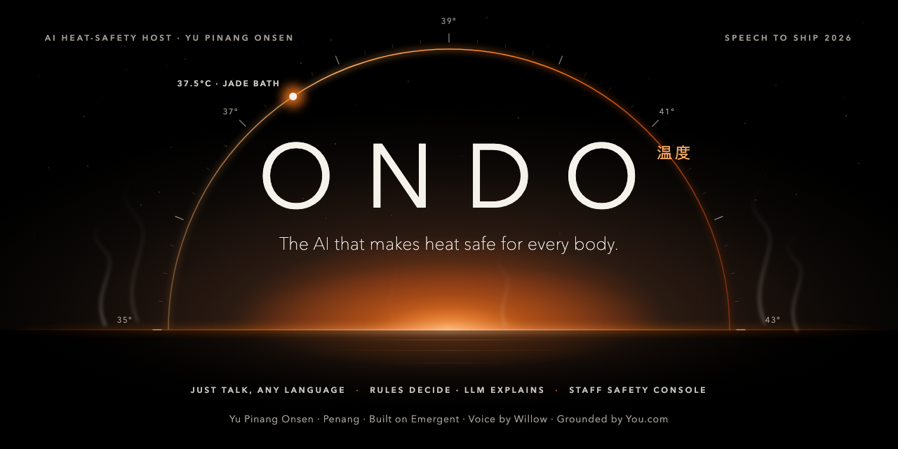
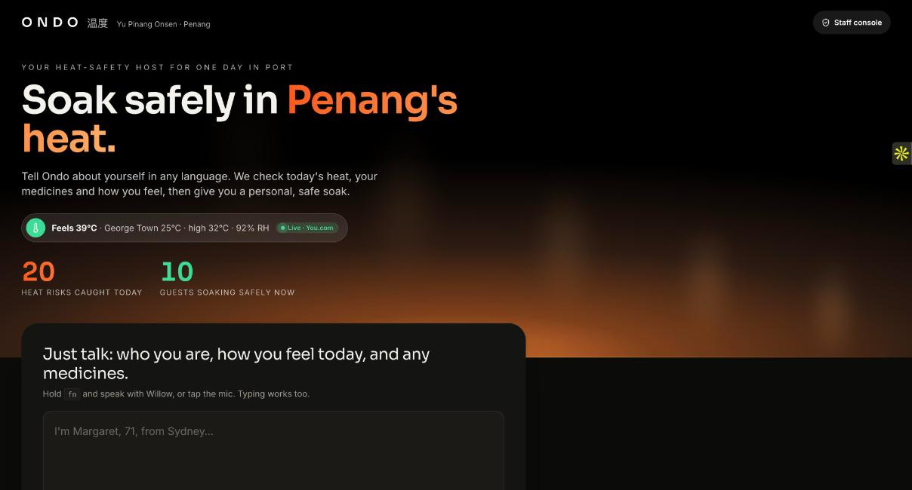
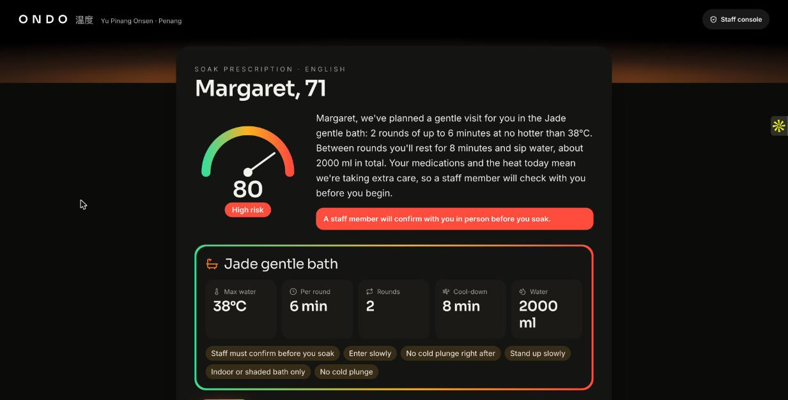
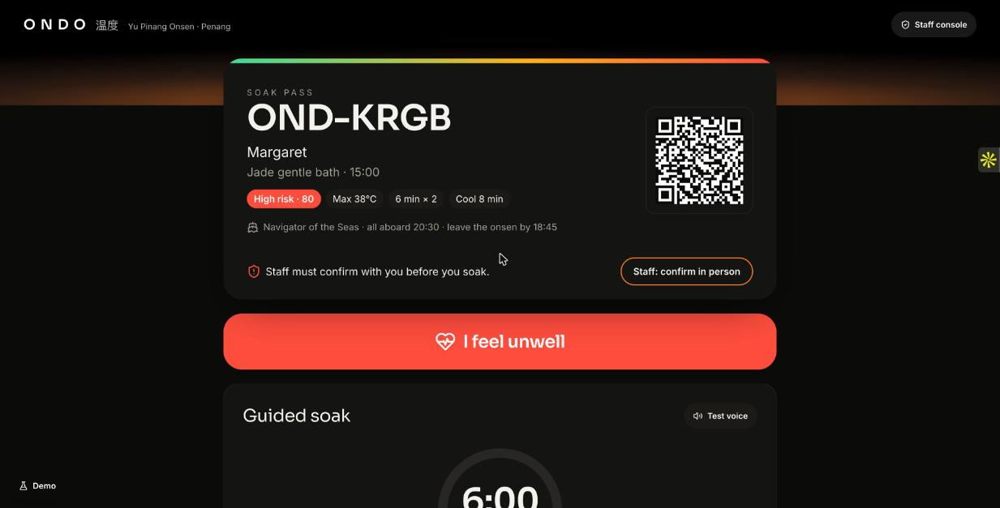
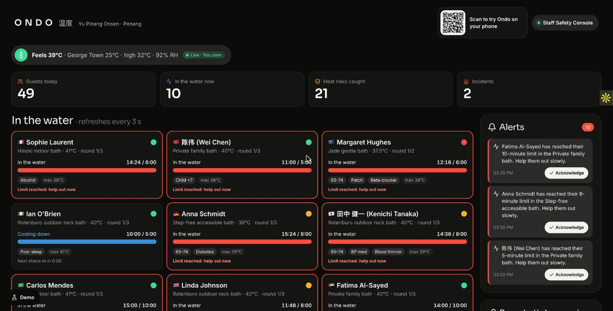
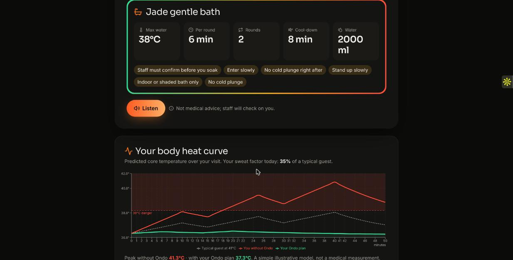
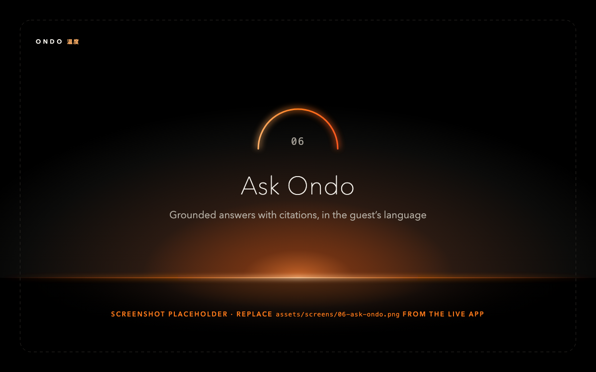
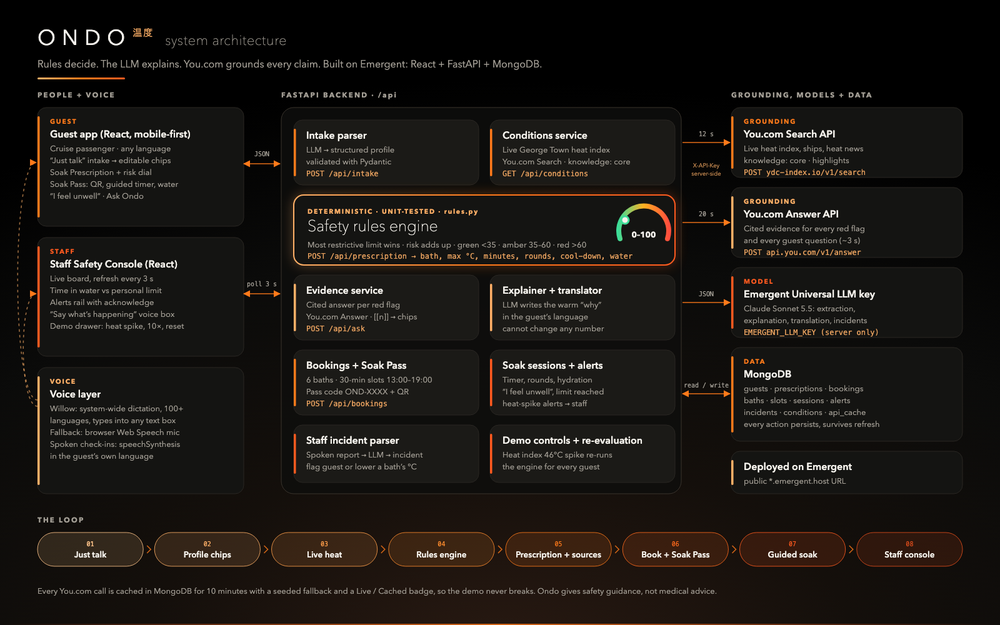
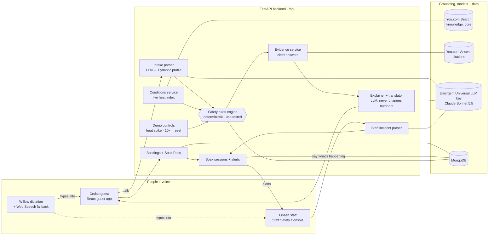

<div align="center">

<a href="https://heat-safe-onsen.emergent.host"></a>

# Ondo 温度

### The AI that makes heat safe for every body.

**Ondo is the AI heat-safety host for Yu Pinang Onsen in Penang.** Cruise passengers just talk, in any language, about who they are, how they feel and the medicines they take. Ondo checks Penang's live heat with You.com, runs a deterministic safety engine, and gives every guest a personal **Soak Prescription**, a guided soak and a staff team that is watching.

[](https://emergent.sh)
[](https://you.com)
[](https://willowvoice.com)
[](#acknowledgements)
<br>
[](https://fastapi.tiangolo.com)
[](https://react.dev)
[](https://www.mongodb.com)
[](LICENSE)
[](#safety--privacy)

**[▶ Live demo](https://heat-safe-onsen.emergent.host)** &nbsp;·&nbsp; **[Pitch deck](deck/Ondo-Pitch.pptx)** &nbsp;·&nbsp; **[3-minute storyboard](docs/STORYBOARD.md)** &nbsp;·&nbsp; **[10-minute demo script](docs/DEMO_SCRIPT.md)** &nbsp;·&nbsp; **[Architecture](docs/ARCHITECTURE.md)** &nbsp;·&nbsp; **[Safety engine](docs/SAFETY_ENGINE.md)** &nbsp;·&nbsp; **[How we chose the idea](docs/TOURNAMENT.md)**

*Soak safely in Penang's heat.*

</div>

---

## Contents

- [The 20-second version](#the-20-second-version)
- [Why Ondo exists](#why-ondo-exists)
- [What it does](#what-it-does)
- [Screenshots](#screenshots)
- [How it works](#how-it-works)
- [The safety engine: rules decide, the LLM explains](#the-safety-engine-rules-decide-the-llm-explains)
- [You.com integration](#youcom-integration)
- [Built by voice with Willow](#built-by-voice-with-willow)
- [Built on Emergent](#built-on-emergent)
- [How we chose the idea](#how-we-chose-the-idea)
- [Business model](#business-model)
- [The trillion-dollar path](#the-trillion-dollar-path)
- [Run it locally](#run-it-locally)
- [API reference](#api-reference)
- [Data model](#data-model)
- [Safety & privacy](#safety--privacy)
- [Roadmap](#roadmap)
- [Contributing](#contributing) · [License](#license) · [Acknowledgements](#acknowledgements)

---

## The 20-second version

> **Margaret, 71, from Sydney**, steps off *Navigator of the Seas* into a 34°C Penang afternoon. She holds `fn` and says:
>
> *"I'm Margaret, 71, from Sydney. I take metoprolol for my blood pressure and I put a seasickness patch on this morning. I'd love a long hot soak."*
>
> Ondo's risk dial swings to **red**. *"Your seasickness patch (scopolamine) stops you sweating. In a 41°C bath on a 34°C Penang day, your body can't cool down."* Ondo moves her from the 41°C Hinoki bath to the **37.5°C Jade bath for 6 minutes**, with cited sources from You.com. Her name lights up on the Staff Safety Console with a personal timer. Then a heat spike hits, and every guest's limit tightens live.
>
> **We just prevented a heat stroke, in her language.**

---

## Why Ondo exists

Heat is a silent, growing killer, and a hot bath stacks heat on heat.

| | The fact | Source |
|---|---|---|
| 🌡️ | About **546,000 heat-related deaths a year** in the last decade (average for 2012–21). | [Lancet Countdown 2025, via PIK Potsdam](https://www.pik-potsdam.de/@@multilingual-selector/3a36822d86b2459e888475c82b430a0c/en) · [report](https://lancetcountdown.org/2025-report/) |
| 👵 | Heat deaths among people **over 65 were 167% higher in 2023** than in the 1990s. | [Lancet Countdown 2024](https://pmc.ncbi.nlm.nih.gov/articles/PMC7616816/) |
| ♨️ | Japan estimates **~19,000 bathing-related deaths a year**, mostly people over 65, from "heat shock". Official advice: water under 41°C, soaks of at most 10 minutes. | [Consumer Affairs Agency, via nippon.com](https://www.nippon.com/en/japan-data/h00623/) |

**Cruise passengers are the highest-risk onsen guests.**

- They are often older, and on blood-pressure pills, beta-blockers or diuretics.
- Many wear **scopolamine seasickness patches, which stop sweating**.
- They are dehydrated after days at sea and the ship's drinks package.
- They step from a 22°C ship into 34°C, humid Penang, and then into a 41°C bath.

The onsen knows none of this about its guests. It puts up a sign. Its staff can't read 20 languages. **Ondo is the host that knows.**

---

## What it does

| | Feature | What the guest or staff member gets |
|---|---|---|
| 🎙️ | **Just talk** | Hold `fn` and speak with Willow, tap the mic, or type, in any language. The LLM turns rambling speech into **editable profile chips**: age, medicines with their generic names and drug classes, conditions, today's factors (drinks, sleep, seasickness, sunburn), pregnancy, children, language and ship. |
| 🌤️ | **Live heat check** | You.com Search with `knowledge: "core"` returns George Town's live temperature, humidity and heat index, shown with a **Live · You.com** badge (or **Cached** when it falls back). |
| 🧭 | **Soak Prescription** | A **deterministic Python rules engine** sets the bath, max °C, minutes per round, rounds, cool-downs and water. A 0–100 **risk dial** runs jade → amber → vermilion. |
| 🚩 | **Cited red flags** | Every red-flag card has a plain-language reason and **evidence chips from the You.com Answer API**, with links to the sources. |
| 🎫 | **Soak Pass** | Booking into real slots, a pass code like `OND-7K2Q`, a QR code, the ship line ("all aboard 20:30 · leave the onsen by 18:45"). |
| ⏱️ | **Guided soak** | Per-round countdowns and cool-downs with **spoken check-ins in the guest's language** ("Margaret, two minutes left. Sit up slowly before you stand."), plus a hydration tracker. |
| 🆘 | **"I feel unwell"** | One big button alerts staff instantly and shows calm steps in the guest's language: get out slowly, sit, sip water, staff are coming. |
| 🩺 | **Health summary** | A generated summary for the ship's doctor, in English plus the guest's language. |
| 🖥️ | **Staff Safety Console** | Every guest in the water with **time in water versus personal limit**, risk colours, red flags, next check-in, an alerts rail with acknowledge, live conditions, today's ships and impact KPIs. Auto-refresh every 3 s. |
| 🗣️ | **"Say what's happening"** | Staff hands are wet, so staff talk: *"Margaret looks dizzy"* or *"Rotenburo is 42 degrees right now."* The LLM turns it into an incident: flag the guest and show the protocol, or lower the bath's temperature and re-check everyone in it. |
| 🔥 | **Heat-spike simulation** | Heat index 46°C re-runs the engine for every guest. Limits tighten, alerts fire and announcements are spoken. |
| 💬 | **Ask Ondo** | *"Can I soak after two beers?"* Grounded answers from You.com with citations, translated into the guest's language. |
| 📱 | **Judges join live** | A QR on the staff console opens the guest app; a new guest appears on the board within 3 seconds. |

---

## Screenshots

> Captured from the live app at https://heat-safe-onsen.emergent.host (Ask Ondo panel is an illustration).

| Just talk | Soak Prescription | Soak Pass |
|---|---|---|
|  |  |  |
| **Staff Safety Console** | **Body heat curve** | **Ask Ondo** |
|  |  |  |

---

## How it works

<p align="center"></p>



**The loop, end to end:** talk → profile chips → live heat → rules engine → prescription with cited red flags → book → Soak Pass → guided soak with spoken check-ins → "I feel unwell" → the staff console shows the guest and the alert → a staff voice incident → heat-spike re-evaluation for everyone.

Full sequence diagrams, caching and fallbacks are in **[docs/ARCHITECTURE.md](docs/ARCHITECTURE.md)**.

---

## The safety engine: rules decide, the LLM explains

The numbers that keep a guest safe are **never** produced by a language model. They come from a small, readable, unit-tested Python rules table (`app/backend/rules.py`). The LLM's jobs are to understand messy speech, to explain the result warmly in the guest's language, and to parse staff incidents. It cannot change a limit.

**Baseline:** max 41°C · 10 min per round · 3 rounds · 5 min cool-down · 250 ml water before and after each round · risk 10.
Every matching rule applies its limit; **the most restrictive limit wins** and the risk points add up.

| Trigger | Max °C | Max min | Rounds | Notes | Risk + |
|---|:-:|:-:|:-:|---|:-:|
| Age 65–74 | 40 | 8 | 3 | enter slowly, no cold plunge right after | 15 |
| Age 75+ | 39 | 6 | 2 | staff check each round | 25 |
| Scopolamine patch / anticholinergics | 38 | 6 | 2 | indoor or shaded only, +500 ml | 30 |
| Beta-blockers | 40 | 8 | – | stand up slowly, no cold plunge | 15 |
| Diuretics | – | 8 | – | +500 ml | 15 |
| Vasodilators, nitrates, PDE5, ACE/ARB | 39 | 8 | – | no alcohol | 15 |
| Anticoagulants | – | – | – | handrails, slip care | 5 |
| Insulin or diabetes | 39 | 8 | – | glucose check, eat first | 15 |
| Pregnancy | 37.5 | 10 | 2 | private bath · first trimester: **red** | 25 |
| Heart disease | 37 | 5 | 1 | clearance · heart attack < 6 months: **red** | 40 |
| Epilepsy | – | – | – | never alone, private bath with companion | 20 |
| Alcohol 1–2 drinks (last 3 h) | 39 | 6 | – | wait 1 hour if possible | 15 |
| Alcohol 3+ drinks | **red**: no hot bath, foot bath only | | | | 40 |
| Poor sleep / seasick today | – | 8 | – | +500 ml | 10 |
| Children under 7 | 38 | 5 | – | adult supervision | 15 |
| Live heat index ≥ 40°C | −1°C on every cap | −2 min | – | shaded or indoor | 10 |
| Live heat index ≥ 45°C | indoor gentle baths only | | | | 20 |

**Risk level:** below 35 is **jade (green)**, 35–60 is **amber**, above 60 or any red rule is **vermilion (red)**. Red means the gentle bath or foot bath only, and staff confirm before the guest soaks. Ondo recommends the bath whose temperature is closest to, but not above, the guest's max °C, honouring privacy needs (private family bath for pregnancy, epilepsy, tattoos or modesty).

**The six baths of Yu Pinang Onsen (seed data):** Hinoki indoor 41°C · Rotenburo outdoor rock bath 40°C (shaded) · Jade gentle bath 37.5°C · Cool plunge 18°C · Private family bath 37–40°C adjustable (tattoo-friendly, modest) · Step-free accessible bath 38°C.

Full table, scoring, bath selection, evidence queries, worked examples and limitations: **[docs/SAFETY_ENGINE.md](docs/SAFETY_ENGINE.md)**.

---

## You.com integration

You.com is live and load-bearing: without it there is no live heat index and no cited evidence. Every call is **server-side only**, sends `X-API-Key` and an explicit `User-Agent: Ondo/1.0`, is cached in MongoDB for 10 minutes, and falls back to seeded data with a **Cached** badge so the demo never breaks.

| Feature | Endpoint | Query |
|---|---|---|
| Live heat index for George Town | **Search** `POST https://ydc-index.io/v1/search` with `knowledge: "core"` | `George Town Penang weather now heat index humidity` |
| Evidence for each red flag | **Answer** `POST https://api.you.com/v1/answer` | `How does {medication or condition} affect heat tolerance and hot bath or sauna safety?` |
| Guest questions ("Can I soak after two beers?") | **Answer** | the guest's question + ` (hot spring onsen safety)` |
| Ships in Penang today (staff console) | **Answer** | `Which cruise ships are in Penang Swettenham Pier on {date}, with arrival and departure times?` |
| Heat news (staff console) | **Search**, freshness `week` | `Penang heatwave heat warning MetMalaysia` |

**How the results are used.** Evidence text comes from `contents.highlights[0]`, then `snippets[0]`, then `description`. Temperature, humidity and "feels like" are parsed from the knowledge description with a regex, with an LLM fallback. Answer's `[[1, 2]]` markers index into `citations` and render as small source chips that link out. The common red-flag queries are pre-warmed at startup, because Answer takes about 3 s.

**Timeouts:** 12 s for Search, 20 s for Answer. On a timeout or any non-200 response the API returns `"live": false` and the UI shows **Cached** instead of an error. Seeded fallback conditions: 33°C, 75% RH, heat index 41°C.

---

## Built by voice with Willow

Voice is the interface, for the people who use Ondo and for the people who built it.

- **Older guests can't type drug names on a phone, but they can say them**, in 100+ languages. The intake box is one big text area labelled *"Just talk: who you are, how you feel today, and any medicines. Hold fn and speak with Willow, or tap the mic."* Willow types straight into it; a browser Web Speech mic is the fallback, with a visible listening state.
- **Staff hands are wet.** The console's *"Say what's happening"* box is built for Willow dictation, so a staff member can report an incident without touching a keyboard.
- **The build itself was spoken.** The product spec and the prompts to Emergent's agent were dictated with Willow. Willow works at the OS level, so it types into Emergent's chat, the deployed app, or anything else with a text field.

**Tips for demoing with Willow:** add `scopolamine`, `metoprolol`, `warfarin`, `Rotenburo`, `Hinoki`, `Swettenham`, `Yu Pinang` and `Ondo` to your Willow personal dictionary, and keep the text visible before you submit so you can fix a misheard drug name. The chips step is the read-back: guests confirm their medicines before the plan is built.

---

## Built on Emergent

The whole two-sided, full-stack app was built by **Emergent's agent** from our spoken prompts and spec:

- **React** guest app and Staff Safety Console, mobile-first, large type and big tap targets for older guests.
- **FastAPI** backend with a unit-tested rules engine, Pydantic-validated LLM output, server-side You.com calls and caching.
- **MongoDB** for guests, prescriptions, bookings, sessions, alerts and incidents, so everything survives a refresh.
- **Emergent Universal LLM key** with Claude Sonnet 5.5 for extraction, explanation, translation and incident parsing.
- **Public `emergent.host` deploy**: [https://heat-safe-onsen.emergent.host](https://heat-safe-onsen.emergent.host).

The app source lives in [`app/`](app/) (`app/frontend` and `app/backend`), exported from Emergent.

---

## How we chose the idea

Team V9 drew the brief at Speech to Ship (no re-rolls): ***"A hot springs onsen for cruise ship passengers with one day in port in Penang, Malaysia."***

We generated **30 ideas** across six angles and ran a tournament. A **simulated panel of about 70 agents**, modelled on the public roles of this event's judges (Emergent, Willow, You.com, Bond AI) plus VC, design and voice-AI archetypes, scored each idea on the official rubric. Twelve simulated cruise-passenger and operator personas reacted to each idea, and a red team attacked build risk, local fit and venture risk. *These are simulations, not endorsements by real people.*

**Finals (top 10, average out of 5):**

| # | Idea | Finals avg | Vision | One line |
|---:|---|:-:|:-:|---|
| 1 | LastCall | 4.39 | 3.08 | An airport departure board for people in bathrobes. |
| 2 | SoakClock | 4.15 | 4.00 | Soak until the last safe minute, guaranteed back on board. |
| **3** | **SoakRx → Ondo** | **3.89** | **3.08** | Speak for 30 seconds and get a soak prescription that knows your meds, today's Penang heat and your all-aboard time. |
| 4 | YuTurn | 3.83 | 3.58 | Tell it your all-aboard time in any language, soak, and make the U-turn back to your ship. |
| 5 | ShipDrop | 3.72 | 5.00 | Every ship gets its own onsen drop: passengers pool before they land. |
| 5 | Rempah-Yu | 3.72 | 2.00 | Speak a memory; it becomes a spice bath today and a jar you carry home. |
| 7 | Bibik-san | 3.60 | 2.00 | Half Nyonya matriarch, half ryokan okami: a voice host who teaches you to bathe right. |
| 8 | PierRunner | 3.46 | 3.42 | If you're going to miss the ship, we already know how you'll catch it. |
| 9 | Berthcast | 3.39 | 4.50 | Every ship that berths becomes a demand forecast, a price ladder and a staffing plan. |
| 10 | SafeSoak | 3.31 | 2.75 | A cited, minute-by-minute soak protocol for today's Penang heat. |

**Why SoakRx became Ondo.** The simulated judges called its spoken scopolamine-patch catch a "gasp moment" and "real empathy". Their critique was just as useful: medication advice reads as liability unless the venue owns it, and they wanted the onsen and staff side "front and centre" with rules deciding and the LLM only explaining. Ondo is that critique, built: a venue-side **Staff Safety Console**, a **deterministic rules engine**, **cited** evidence and a read-back of every medicine. Full method, all 30 ideas and scores: **[docs/TOURNAMENT.md](docs/TOURNAMENT.md)**.

---

## Business model

| Who pays | What they buy | Why |
|---|---|---|
| **Venues**: onsen, spas, saunas, thermal baths | Per-guest SaaS, about **US$0.50–1 per guest**, or a monthly plan | It replaces a laminated sign and closes a liability gap. |
| **Insurers** | Lower premiums for venues that run Ondo; Ondo shares the saving | Fewer incidents and an audit trail. |
| **Cruise lines** | Licensing for ship spas, medical centres and shore excursions | They already know their guests' risk profiles. |
| **Consumers and employers** (next) | A personal heat-safety subscription for people over 65 and their families; heat-safety compliance for employers of outdoor workers | The same engine, pointed at everyday heat. |

---

## The trillion-dollar path

**Wedge → engine → category.**

1. **Wedge.** One Penang onsen shows that cruise guests soak more safely, stay longer and spend more.
2. **Thermal venues worldwide.** Japan's ~27,000 onsen facilities, saunas, spas and thermal baths, plus cruise-ship spas.
3. **Personal heat safety.** The same engine tells anyone what their body can take today: older adults, outdoor workers, athletes, travellers. Billions now live through dangerous heat every year.
4. **Category.** The health layer of climate adaptation, where the ~US$6T+ wellness economy, health insurance and climate resilience meet.

> **Make heat safe for every body.**

---

## Run it locally

Ondo is a standard Emergent stack: **FastAPI + MongoDB + React**. The app source lands in [`app/`](app/) from Emergent; **the exact commands below will be matched to `app/` once the code lands** (check `app/backend/requirements.txt` and `app/frontend/package.json`).

**Prerequisites:** Python 3.11+, Node 18+ with Yarn, MongoDB 6+ (local or Atlas), a [You.com API key](https://you.com/platform) and an Emergent Universal LLM key.

```bash
git clone https://github.com/vnmoorthy/ondo.git
cd ondo
cp .env.example .env              # then fill in the values below
```

| Variable | Used by | What it is |
|---|---|---|
| `MONGO_URL` | backend | MongoDB connection string, e.g. `mongodb://localhost:27017` |
| `DB_NAME` | backend | Database name, e.g. `ondo` |
| `YDC_API_KEY` | backend | You.com API key (sent as `X-API-Key`, never to the browser) |
| `EMERGENT_LLM_KEY` | backend | Emergent Universal LLM key (Claude Sonnet 5.5) |
| `REACT_APP_BACKEND_URL` | frontend | Where the React app finds the API, e.g. `http://localhost:8001` |

**Backend**

```bash
cd app/backend
python -m venv .venv && source .venv/bin/activate
pip install -r requirements.txt
uvicorn server:app --reload --host 0.0.0.0 --port 8001
pytest -q                          # runs the rules-engine unit tests
```

**Frontend**

```bash
cd app/frontend
yarn install
yarn start                         # http://localhost:3000
```

Open `http://localhost:3000` for the guest app and `http://localhost:3000/staff` for the Staff Safety Console. With no `YDC_API_KEY`, Ondo runs on its seeded fallbacks and shows **Cached** badges.

---

## API reference

All routes are under `/api`. The first five are defined in the product spec; the rest describe the planned surface and **will be confirmed against `app/backend` once the code lands**.

| Method | Path | Purpose |
|---|---|---|
| `GET` | `/api/conditions` | Live George Town temperature, humidity and heat index from You.com Search (`live: true/false`) |
| `POST` | `/api/intake` | `{text}` → structured guest profile (LLM, Pydantic-validated) |
| `POST` | `/api/prescription` | `{profile}` → rules-engine prescription, risk score and level, red flags with You.com evidence, explanation in the guest's language |
| `POST` | `/api/bookings` | Book a bath and slot → pass code like `OND-7K2Q` |
| `POST` | `/api/ask` | Grounded answer with citations from You.com Answer, translated |
| `GET` | `/api/baths`, `/api/slots` | The six baths and 30-minute slots from 13:00 to 19:00 with capacity |
| `GET` | `/api/pass/{code}` | Pass, prescription summary and ship line |
| `POST` | `/api/pass/{code}/…` | Start soak, log water, **"I feel unwell"** |
| `GET` | `/api/pass/{code}/health-summary` | Summary for the ship's doctor (English plus the guest's language) |
| `GET` | `/api/staff/board` | Guests in the water, time versus limit, risk, red flags, next check-in |
| `GET` / `POST` | `/api/staff/alerts`, `/api/staff/alerts/{id}/ack` | Alerts rail and acknowledge |
| `POST` | `/api/staff/incident` | `{text}` → incident (flag a guest, or lower a bath's °C and re-check everyone in it) |
| `GET` | `/api/staff/kpis`, `/api/ships` | Impact KPIs; ships in Penang today |
| `POST` | `/api/demo/heat-spike`, `/api/demo/fast-forward`, `/api/demo/reset` | Demo drawer |

Example:

```bash
curl -s -X POST "$REACT_APP_BACKEND_URL/api/intake" \
  -H 'Content-Type: application/json' \
  -d '{"text":"I am Margaret, 71, from Sydney. I take metoprolol and I put a seasickness patch on this morning."}'
```

---

## Data model

MongoDB collections (names will be matched to `app/backend` once the code lands):

| Collection | Holds |
|---|---|
| `guests` | Profile from intake: name, age, language, home country, ship, party, medications (as said, generic name, class), conditions, today's factors, pregnancy weeks, children's ages |
| `prescriptions` | Engine output: bath, max °C, minutes, rounds, cool-down, water, risk score and level, matched rule ids with reasons and evidence, explanation |
| `baths` | The six baths with temperature, indoor/outdoor, privacy and accessibility flags |
| `slots` / `bookings` | 30-minute slots with capacity; bookings with pass code, guest, bath and time |
| `sessions` | Guided soaks: round, time in water, personal limit, hydration log, next check-in |
| `alerts` | Limit reached, "I feel unwell", heat-index spikes; acknowledged by and when |
| `incidents` | Staff voice reports and the structured action taken |
| `conditions` / `api_cache` | You.com responses cached for 10 minutes, keyed by endpoint and normalized query |

---

## Safety & privacy

> **Ondo gives safety guidance, not medical advice.** It does not diagnose, treat or replace a doctor. It applies conservative, published-guidance-style limits to help an onsen keep guests safe, and staff check on every guest. When in doubt, Ondo says "don't soak today" and asks staff to confirm.

- **Rules decide, the LLM explains.** Limits come from a deterministic, unit-tested table. The LLM cannot raise a limit; its output is validated with Pydantic.
- **Every red flag is cited.** Evidence comes from the You.com Answer API with visible sources.
- **Read-back.** Guests see and edit what Ondo heard (medicines especially) before a prescription is built.
- **Health data stays minimal.** Ondo asks only what it needs for today's soak and never asks for an ID or a card. API keys stay on the server. The guest's words go to the LLM (through Emergent's Universal LLM key) to build the profile and the explanation; You.com evidence queries carry a medicine or condition name, never the guest's name.
- **Production checklist for venues.** Get explicit consent at intake, set a short retention window, restrict the staff console to staff, and follow local health-data law (in Malaysia, the PDPA).
- **Voice.** Willow is the speaker's own dictation app and types text into Ondo; the browser mic fallback uses the Web Speech API. Ondo receives and stores text, not audio.

---

## Roadmap

- [ ] Real screenshots and a 60-second demo video in this README
- [ ] Consent screen and per-venue data-retention setting
- [ ] Medication dictionary expansion with pharmacist review, and a "we didn't recognise this medicine" path that always asks staff
- [ ] Staff sign-in and an exportable incident audit trail for insurers
- [ ] Wearable and water-temperature sensor input for the console
- [ ] Multi-venue dashboard for spa groups and cruise-ship spas
- [ ] Personal heat-safety mode for everyday heat: older adults, outdoor workers, athletes

---

## Contributing

Ideas, bug reports and pull requests are welcome. Please read **[CONTRIBUTING.md](CONTRIBUTING.md)** first; changes to the safety rules need a source and a unit test.

## License

[MIT](LICENSE) © 2026 Team V9 (Ondo).

## Acknowledgements

- **[Emergent](https://emergent.sh)** for hosting Speech to Ship at Emergent HQ, San Francisco (Nov 20, 2026), and for the agent that built this app.
- **[You.com](https://you.com)** for the Search and Answer APIs that ground every claim.
- **[Willow](https://willowvoice.com)** for making voice the keyboard.
- **Bond AI** for co-running the event.
- The **Lancet Countdown**, **PIK Potsdam**, Japan's **Consumer Affairs Agency** and **nippon.com** for the data that made the problem impossible to ignore.

<div align="center">
<br>
<b>Ondo 温度</b> · Yu Pinang Onsen · Penang<br>
<i>Make heat safe for every body.</i>
</div>
