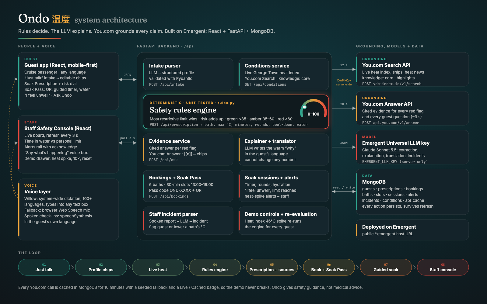
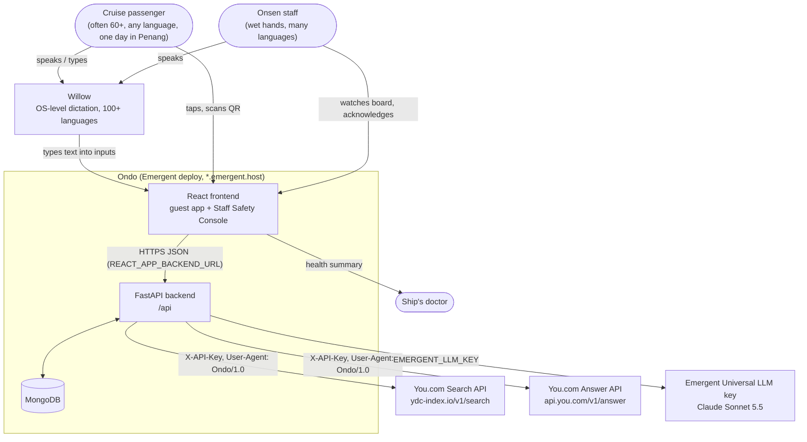
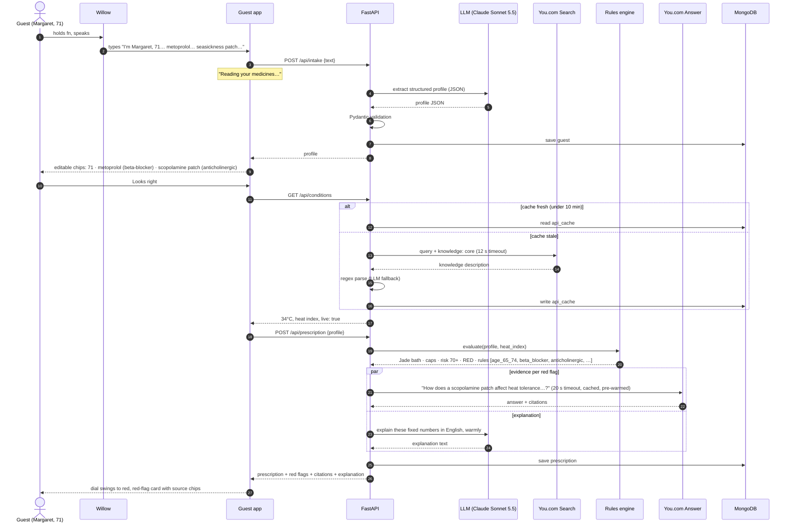
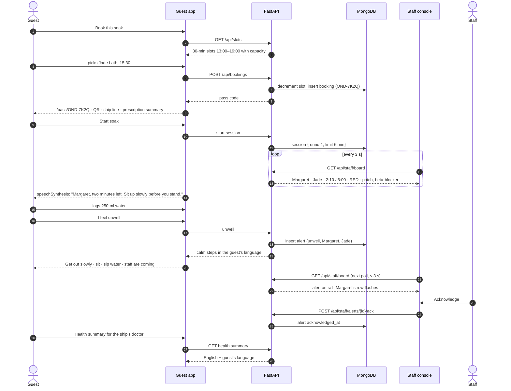
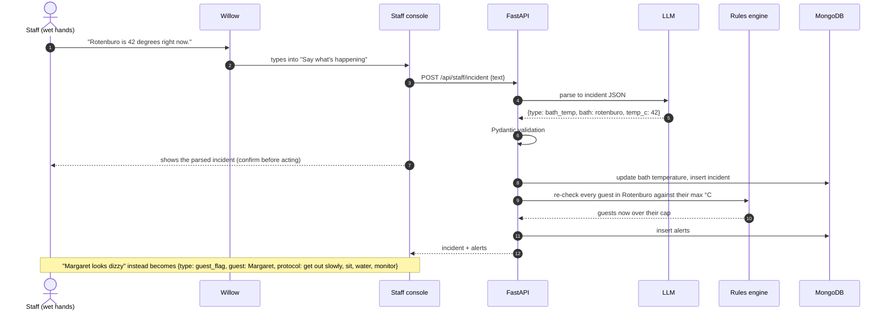
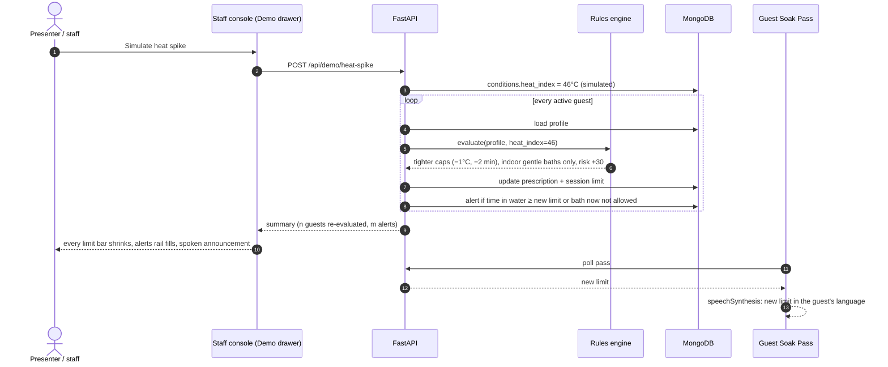

# Ondo architecture

> **Rules decide. The LLM explains. You.com grounds every claim.**
> Ondo is a two-sided web app (guest app + Staff Safety Console) built on Emergent: React + FastAPI + MongoDB, with You.com for live, cited facts and Willow as the voice interface.

The app source is exported from Emergent into [`app/frontend`](../app/frontend) and [`app/backend`](../app/backend). Where this document names a route, module or collection that the spec does not fix, it describes the intended design; `app/` is the source of truth once it lands.

---

## 1. System context

**Trust boundaries.** The browser never sees an API key. Everything external (You.com, the LLM) is called from FastAPI. The deterministic rules engine sits between the LLM and the guest: the LLM proposes a profile, the engine decides the limits, and the LLM only explains the result.

---

## 2. Components

### Frontend (`app/frontend`, React)

| Route | Screen | Key parts |
|---|---|---|
| `/` | Landing + **Just talk** intake | Live heat chip ("Live · You.com"), one large text area built for Willow dictation, Web Speech mic fallback with a visible listening state, five multilingual persona chips (Margaret, Mr. Tanaka, Priya, David, the Chen family), "Why Ondo" strip with sourced stats, editable profile chips with **Looks right** |
| `/prescription/:id` | **Soak Prescription** | 0–100 risk dial (jade → amber → vermilion), prescription card, red-flag cards with You.com evidence chips, explanation in the guest's language, "Not medical advice; staff will check on you", **Book this soak**, **Ask Ondo** |
| `/pass/:code` | **Soak Pass** | QR of the pass URL, ship line ("all aboard 20:30 · leave the onsen by 18:45"), guided soak timer with spoken check-ins (`speechSynthesis`), hydration tracker, **I feel unwell**, health summary for the ship's doctor, **Ask Ondo**, Demo drawer |
| `/staff` | **Staff Safety Console** | Live board polled every 3 s, alerts rail with acknowledge, **Say what's happening** voice box, live conditions, ships in Penang today, impact KPIs, a QR that opens the guest app, Demo drawer |

Design system: ink `#101418`, steam white `#F7F5F2`, deep teal `#0E3B43`, jade `#2FA58F` (safe), amber `#E9A23B` (caution), vermilion `#E2483D` (danger); Fraunces for headings, Inter for UI. Large type and tap targets; no silent spinners ("Checking Penang's heat on You.com…", "Reading your medicines…").

### Backend (`app/backend`, FastAPI)

| Module | Responsibility |
|---|---|
| **Intake parser** | LLM turns free speech into a structured profile (name, age, language, home country, ship, party, medications as said + generic + class, conditions, today's factors, pregnancy weeks, children's ages). Output is validated with Pydantic; invalid JSON is retried once, then falls back to a minimal profile the guest edits. |
| **Conditions service** | You.com Search with `knowledge: "core"` for George Town's temperature, humidity and heat index. Regex parse of the knowledge description, LLM fallback, seeded fallback (33°C, 75% RH, heat index 41°C, `live: false`). |
| **Safety rules engine** (`rules.py`) | Pure, deterministic Python. Input: profile + heat index. Output: bath, max °C, minutes, rounds, cool-down, water, risk score and level, matched rules with reasons and evidence queries. Unit-tested. See [SAFETY_ENGINE.md](SAFETY_ENGINE.md). |
| **Evidence service** | You.com Answer for each matched rule's evidence query and for guest questions. Parses `[[n]]` citation markers into source chips. Pre-warms common red-flag queries at startup. |
| **Explainer + translator** | LLM writes the warm explanation, check-in lines, unwell steps and the doctor summary in the guest's language. It receives the engine's numbers as read-only facts. |
| **Bookings + Soak Pass** | Six seeded baths, 30-minute slots 13:00–19:00 with capacity, pass codes like `OND-7K2Q`, the ship line from the guest's ship and all-aboard time. |
| **Soak sessions + alerts** | Session state (round, time in water, personal limit, hydration, next check-in). Raises alerts for limit reached, "I feel unwell" and heat-index spikes. |
| **Staff incident parser** | LLM turns a spoken staff report into a typed incident: flag a guest with a protocol, or change a bath's temperature and re-check everyone in it. |
| **Demo controls** | Fast-forward (timers 10×), heat spike (heat index 46°C, re-run the engine for every active guest), reset (re-seed about 10 soaking guests with mixed risk). |

### Data (MongoDB)

`guests`, `prescriptions`, `baths`, `slots`, `bookings`, `sessions`, `alerts`, `incidents`, `conditions` / `api_cache`. Every user action persists, so any page survives a refresh and the staff console sees the same state as the guest's phone. See the [data model in the README](../README.md#data-model).

---

## 3. Sequence diagrams

### 3.1 Intake → profile → live heat → rules → prescription with citations

### 3.2 Booking → pass → guided soak → "I feel unwell" → staff console

### 3.3 Staff voice incident

### 3.4 Heat-spike re-evaluation

---

## 4. Caching and fallbacks

The demo must hold up live for 10 minutes on venue Wi-Fi, so every external dependency has a fallback.

| Dependency | Timeout | Cache | Fallback | UI |
|---|---|---|---|---|
| You.com Search (heat) | 12 s | MongoDB, 10 min, key = endpoint + normalized query | Seeded: 33°C, 75% RH, heat index 41°C | **Live · You.com** or **Cached** |
| You.com Answer (evidence, questions, ships) | 20 s | MongoDB, 10 min; common red-flag queries pre-warmed at startup | Last cached answer, else a seeded evidence line for that rule | Source chips; **Cached** badge |
| LLM intake | ~10 s | none | Minimal profile from keyword matching; guest edits the chips | "Reading your medicines…" |
| LLM explanation / translation | ~10 s | per prescription | Template sentence in English built from the engine's reasons | Explanation still shows |
| Ships in Penang | 20 s | 10 min | Seed: Navigator of the Seas, Fri Nov 20 2026, 14:00–21:00 | **Cached** |

Rules that never depend on the network: the safety limits, risk level and bath choice. If every external call fails, a guest still gets a correct, conservative prescription.

---

## 5. Security

- **Keys server-side only.** `YDC_API_KEY` and `EMERGENT_LLM_KEY` live in backend environment variables; the frontend only knows `REACT_APP_BACKEND_URL`. `.env` is git-ignored; `.env.example` lists names without values.
- **Explicit User-Agent** (`Ondo/1.0`) on You.com calls; Cloudflare blocks the bare Python-urllib agent.
- **LLM output is untrusted input.** Every LLM response is parsed as JSON and validated with Pydantic before use. The LLM never writes limits; the engine ignores any numbers in LLM text.
- **Prompt-injection resistance.** Guest and staff text is passed to the LLM as data inside a fixed extraction schema; incident actions are limited to a small typed set (flag guest, change a bath temperature) and are shown to staff before they apply.
- **Minimal health data.** Only what the guest says for today's soak; no IDs, no payment details, no audio. Evidence queries sent to You.com contain a medicine or condition, never a name.
- **Hackathon scope, production gaps.** The demo console has no staff login, and demo controls are open. Before a real venue uses Ondo: staff auth, role-based access to the console, consent at intake, a retention window, audit logging and rate limits.
