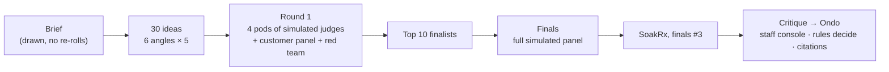

# How we chose Ondo: a 30-idea tournament

> **Everything on this page is a simulation.** The judges, passengers and operators below are AI personas that we modelled on public roles and public information, to stress-test ideas before we built. They are **not** the real people, and nothing here is an endorsement, a quote or a score from anyone real. Quotes are labelled as simulated.

Team V9 drew the Speech to Ship brief, with no re-rolls:

> ***"A hot springs onsen for cruise ship passengers with one day in port in Penang, Malaysia."***

We had one afternoon to build. Rather than pick the first idea that sounded good, we generated 30, scored them the way this event's judges might, listened to the customers, sent in a red team, and then built the idea that survived.

---

## 1. Method

1. **Ideas.** Thirty ideas across six angles: guest concierge, back on time, platform vision, wellness and health, culture and creative, and operator B2B. Each idea had a problem with sources, a solution, a demo flow, a wow moment, how it would use Emergent, Willow and You.com, a business model, a path to a very large company, core screens, a 2-hour buildability check and risks.
2. **Rubric.** The official Speech to Ship categories, each 1–5 with equal weight: **brief fit** (onsen, cruise passenger *and* Penang), **works live** (will the main flow work end to end on the public URL after a short build?), **craft**, **tool use** (Emergent full-stack, You.com live and cited, Willow as the natural input) and **creativity**. We added a team-only **vision** score: real-world impact and a credible venture path. Judges were told to use the full range and give at most two 5s per category.
3. **Round 1.** The ideas were split into four pods. In total, a **simulated panel of about 70 agents** took part across the tournament: judge personas modelled on the event's sponsors and community (Emergent, Willow, You.com, Bond AI) plus VC, design and voice-AI archetypes; twelve cruise-passenger and operator personas; and a red team. The composite score that picked the ten finalists combines the official-rubric average with the vision, customer-panel and red-team signals.
4. **Finals.** The ten finalists were re-scored by the full judge panel, with each judge saying what it would take to earn a 5.
5. **Build.** We took the finals feedback on our chosen idea as a spec change, not a compliment.

---

## 2. The simulated personas

### Judge personas

Simulated personas modelled on public roles. Not the real people, and not endorsements.

| Persona id | Modelled on (public role) | Organisation, as described in our research brief |
|---|---|---|
| `mukund_jha` | Mukund Jha, Co-founder & CEO | Emergent (emergent.sh), host sponsor and venue |
| `madhav_jha` | Madhav Jha, Co-founder & CTO | Emergent |
| `allan_guo` | Allan Guo, Co-founder & CEO | Willow (willowvoice.com), host sponsor |
| `lawrence_liu` | Lawrence Liu, Co-founder & CTO | Willow |
| `sharath_kuruganty` | Sharath Kuruganty, Luma co-host (Willow side, per organizer brief) | Willow (title unverified; probably community, growth or events, guess) |
| `richard_socher` | Richard Socher, Founder & CEO (co-founder and CTO Bryan McCann shares this lens) | You.com, presenting sponsor (APIs at ydc-index.io) |
| `tina_park` | Tina Park, Developer Relations (per organizer brief) | You.com (Luma co-host 'devtinapark'; title unverified) |
| `sahar_mor` | Sahar Mor, Founder of the Bond AI community; author of AI Tidbits | Bond AI (featured community, co-runs the event) |
| `sponsor_pod_judge` | Archetype: sponsor-side Round-1 pod judge (based on Luma co-hosts Kyle Morrison, Madison Lee, Manish Tyagi) | Emergent, You.com or Willow staff (these three co-hosts' companies are unverified; guess: GTM, partnerships, community or solutions engineering) |
| `seed_vc_partner` | Archetype: seed-stage VC partner (SF, AI apps) | A seed fund close to the sponsors (e.g. Emergent investors Lightspeed, Together, YC or Khosla, or Socher's AIX Ventures); illustrative, not confirmed |
| `product_design_lead` | Archetype: product/design lead focused on craft | Design team at an AI-native startup or big tech (the Bond AI judge-pool type); illustrative |
| `voice_ai_founder` | Archetype: voice-AI startup founder or speech engineer | An SF voice-agent or speech startup (speech-to-text, text-to-speech, realtime agents); illustrative, the Bond AI judge-pool type |

Each persona had a "what they reward" list, red flags, wow triggers and a scoring lens. For example, the Emergent-CEO lens asks *"could the business on this team's card run its day on this app tomorrow?"*, and the You.com-founder lens asks whether live, cited data is doing real work.

### Customer and operator panel

| Persona id | Who |
|---|---|
| `aus_retirees` | Retired Australian couple (68 and 71) from Brisbane on Royal Caribbean's Navigator of the Seas. First time in Asia. He has a bad knee. They are anxious about missing the 8:30 PM all-aboard and about heat. They use iPhones with large text. |
| `shanghai_family` | Chinese family of four from Shanghai (kids 6 and 9) on Resorts World / Genting Dream. Mandarin only, use WeChat and Alipay, want something the kids enjoy, worry about hygiene and safety. |
| `mumbai_honeymoon` | Indian honeymoon couple (28 and 30) from Mumbai. Vegetarian, budget-conscious, want Instagram-worthy moments and privacy as a couple, have 7 hours ashore. |
| `tokyo_onsen_purist` | Japanese solo traveler (46) from Tokyo who grew up with real onsen. Deeply skeptical of 'fake onsen' abroad, cares about water source, etiquette and authenticity. |
| `us_tattoo_wellness` | American woman (52) from Austin with sleeve tattoos, wellness enthusiast, travels solo on Celebrity. Has been turned away from Japanese onsen for tattoos. Terrified of missing the ship after a past close call. |
| `german_planners` | German couple (63 and 65) from Munich on Oceania. Meticulous planners, privacy- and data-conscious, want nature and quiet, hate crowds and tourist traps, will compare prices. |
| `muslim_family_sg` | Muslim Malay-Singaporean family (parents 40s, teen daughter 15) on a regional cruise. Need modest, gender-separated bathing, halal food, prayer time and space; the mother wears hijab. |
| `uk_remote_worker` | British solo traveler (34), remote product manager, spontaneous, hates group tours and queues, wants to book in 30 seconds from the gangway and be back on the ship working by 4 PM. |
| `korean_friends` | Group of four Korean women (late 20s) from Seoul, into K-beauty, spa culture and wellness, very app-savvy, will share everything on Instagram and Naver. |
| `canada_wheelchair` | Canadian man (58) from Vancouver who uses a wheelchair, travelling with his wife. Needs step-free access, accessible changing rooms and a guaranteed accessible taxi. |
| `shore_ex_manager` | Shore excursions manager for a major cruise line in Asia (B2B buyer). Decides which local partners the cruise line sells and distributes on board. Cares about safety, liability, on-time return, margin, guest ratings. |
| `onsen_owner` | The founder and operator of the new hot springs onsen in Penang. Needs to fill capacity when ships dock, handle surge and multilingual guests, avoid no-shows, and grow revenue with limited staff. |

### Red team

Three red-team lenses scored each idea 1–5 and named its biggest pitfall and fix: **build** (will it break on stage after a short build?), **local** (does it fit Penang, its port and its people?) and **VC** (is there a large business here?).

---

## 3. Round 1: all 30 ideas

Composite = the Round 1 score used to pick the ten finalists (higher is better). Category columns are the official-rubric averages (1–5). Vision and Customers are 1–5 averages.

| # | Idea | Angle | Composite | Official avg | Brief fit | Works live | Craft | Tool use | Creativity | Vision | Customers | Finalist |
|---:|---|---|---:|---:|---:|---:|---:|---:|---:|---:|---:|:---:|
| 1 | SoakClock | back-on-time | 6.05 | 4.43 | 5.00 | 4.00 | 4.00 | 4.83 | 4.33 | 4.33 | 3.53 | ✓ |
| 2 | Bibik-san: Your Onsen Auntie | culture-creative | 5.97 | 4.23 | 5.00 | 4.00 | 3.83 | 4.33 | 4.00 | 4.67 | 2.81 | ✓ |
| 3 | LastCall | back-on-time | 5.78 | 4.47 | 4.67 | 3.83 | 4.67 | 4.50 | 4.67 | 3.50 | 2.92 | ✓ |
| 4 | SafeSoak | guest-concierge | 5.68 | 4.40 | 4.83 | 4.33 | 4.33 | 4.33 | 4.17 | 3.17 | 2.28 | ✓ |
| 5 | ShipDrop | platform-vision | 5.67 | 4.07 | 4.33 | 3.50 | 4.17 | 4.00 | 4.33 | 4.67 | 2.92 | ✓ |
| 6 | Rempah-Yu: The Spice-Route Memory Bath | culture-creative | 5.65 | 4.13 | 4.00 | 5.00 | 4.50 | 3.17 | 4.00 | 3.17 | 2.81 | ✓ |
| 7 | Berthcast | operator-b2b | 5.63 | 4.13 | 4.33 | 3.67 | 3.83 | 4.50 | 4.33 | 4.17 | 2.03 | ✓ |
| 8 | YuTurn | guest-concierge | 5.60 | 4.17 | 4.83 | 4.00 | 4.17 | 4.67 | 3.17 | 3.67 | 3.47 | ✓ |
| 9 | PierRunner | back-on-time | 5.54 | 3.97 | 3.33 | 3.50 | 4.00 | 4.67 | 4.33 | 4.00 | 2.83 | ✓ |
| 10 | **SoakRx → Ondo** | wellness-health | 5.52 | 4.20 | 4.00 | 4.17 | 4.33 | 4.00 | 4.50 | 3.33 | 2.25 | ✓ |
| 11 | AllAboard | platform-vision | 5.50 | 3.80 | 4.00 | 3.00 | 3.83 | 4.17 | 4.00 | 4.83 | 3.31 |  |
| 12 | Toji | wellness-health | 5.41 | 4.00 | 3.83 | 4.17 | 4.50 | 3.50 | 4.00 | 4.50 | 1.89 |  |
| 13 | Benang Merah: The Red Thread Onsen | culture-creative | 5.41 | 4.07 | 3.67 | 3.00 | 4.00 | 4.83 | 4.83 | 4.17 | 2.00 |  |
| 14 | Comfort Passport | platform-vision | 5.39 | 4.00 | 4.67 | 3.17 | 3.83 | 3.83 | 4.50 | 3.17 | 2.97 |  |
| 15 | ShipClock | operator-b2b | 5.28 | 3.70 | 4.00 | 3.67 | 3.50 | 4.17 | 3.17 | 4.50 | 3.03 |  |
| 16 | Onsen Sensei | guest-concierge | 5.24 | 3.93 | 4.50 | 3.33 | 3.83 | 3.50 | 4.50 | 3.50 | 2.86 |  |
| 17 | Noren | operator-b2b | 5.18 | 3.90 | 4.67 | 4.17 | 3.83 | 3.50 | 3.33 | 3.17 | 2.28 |  |
| 18 | RainCheck | operator-b2b | 5.06 | 3.50 | 3.67 | 3.50 | 3.17 | 4.17 | 3.00 | 4.00 | 2.75 |  |
| 19 | GentlePort | wellness-health | 4.99 | 3.80 | 4.00 | 3.83 | 4.17 | 3.67 | 3.33 | 3.17 | 2.67 |  |
| 20 | Kawan | guest-concierge | 4.72 | 3.50 | 4.00 | 2.00 | 2.83 | 4.33 | 4.33 | 4.17 | 2.17 |  |
| 21 | AgentPort | platform-vision | 4.56 | 3.20 | 3.33 | 2.00 | 2.83 | 4.00 | 3.83 | 5.00 | 1.75 |  |
| 22 | Gangway | operator-b2b | 4.42 | 3.30 | 3.50 | 2.17 | 2.83 | 4.00 | 4.00 | 4.17 | 1.53 |  |
| 23 | Ichigo Ichie: One Day, One Scroll | culture-creative | 4.42 | 3.30 | 4.17 | 2.00 | 3.17 | 3.83 | 3.33 | 3.67 | 2.33 |  |
| 24 | Kopitiam Council | guest-concierge | 4.39 | 3.40 | 3.50 | 2.00 | 2.83 | 4.17 | 4.50 | 3.33 | 2.03 |  |
| 25 | LowTide | platform-vision | 4.35 | 3.10 | 3.00 | 2.00 | 3.17 | 3.17 | 4.17 | 3.67 | 3.22 |  |
| 26 | ShipWave | back-on-time | 4.30 | 3.13 | 3.67 | 2.33 | 2.83 | 3.67 | 3.17 | 3.67 | 2.69 |  |
| 27 | PenkiPenang: The Living Bathhouse Mural | culture-creative | 4.12 | 3.27 | 3.33 | 2.00 | 3.00 | 3.00 | 5.00 | 2.67 | 2.28 |  |
| 28 | SailAway Sleep | wellness-health | 4.10 | 3.33 | 2.50 | 3.17 | 3.83 | 3.00 | 4.17 | 2.33 | 2.25 |  |
| 29 | HeatDose | wellness-health | 4.04 | 3.00 | 2.67 | 3.00 | 3.17 | 3.17 | 3.00 | 3.00 | 1.94 |  |
| 30 | Muster | back-on-time | 3.89 | 2.93 | 3.00 | 2.00 | 2.83 | 3.17 | 3.67 | 3.00 | 2.36 |  |

<b>The 30 ideas in one line each</b>

**guest-concierge**

- **YuTurn** (`guest-concierge-1`): Speech to Ship, literally: tell it your all-aboard time in any language, soak in Penang's onsen, and make the U-turn back to your ship with a live-guarded buffer and a one-tap rescue plan.
- **Onsen Sensei** (`guest-concierge-2`): Rehearse the onsen in your own language during the 15-minute ride from the pier, get matched to the bath that suits your body, beliefs and tattoos, and walk in like a regular.
- **SafeSoak** (`guest-concierge-3`): A personal soak prescription for today's Penang heat: describe your health in any language, get a cited, minute-by-minute protocol, and let a voice coach keep you safe and on time for the ship.
- **Kawan** (`guest-concierge-4`): You talk to Kawan (Malay for 'friend') in your own language. Kawan talks to the onsen's AI, negotiates, checks its claims against live web data, and books your whole port day while you watch.
- **Kopitiam Council** (`guest-concierge-5`): Grandma speaks Mandarin, Dad Hindi, Mom Malay, the teen English. Everyone talks at once, and one onsen-centered port day comes back to each of them in their own language, with the family splitting up and rejoining so everyone gets their wish and makes the ship.

**back-on-time**

- **SoakClock** (`back-on-time-1`): Soak until the last safe minute, guaranteed back on board.
- **PierRunner** (`back-on-time-2`): If you're going to miss the ship, we already know how you'll catch it.
- **LastCall** (`back-on-time-3`): An airport departure board for people in bathrobes.
- **ShipWave** (`back-on-time-4`): See the human tide before it hits the island, and sell only slots that make the ship.
- **Muster** (`back-on-time-5`): The onsen is your family's shore muster station. Everyone gets back aboard.

**platform-vision**

- **ShipDrop** (`platform-vision-1`): Every ship that docks in Penang gets its own onsen drop: passengers pool before they land and unlock a private, ship-only soak that costs less than the ship's own excursion.
- **AllAboard** (`platform-vision-2`): The onsen that guarantees you get back on board. Say your plan for the day, watch the risk of missing your ship get priced live, and if you still miss it, we get you to the next port.
- **AgentPort** (`platform-vision-3`): Your AI and the onsen's AI negotiate your Penang port day live, citing sources, in your language, and get you back before all-aboard. It's the first business on a network where AI agents book the real world.
- **LowTide** (`platform-vision-4`): When two ships pour 6,000 people into George Town at 10 AM, LowTide pays passengers to soak at the quiet hour. The crowd peak flattens and the onsen's empty afternoon fills.
- **Comfort Passport** (`platform-vision-5`): Say your needs once (modesty, tattoos, halal, mobility, nerves) and the Penang onsen rearranges itself before you step off the ship. The same passport works at every port.

**wellness-health**

- **SoakRx** (`wellness-health-1`): Speak for 30 seconds and get a soak prescription that knows your meds, today's Penang heat and your all-aboard time.
- **Toji** (`wellness-health-2`): Tell us where it hurts. Leave Penang with a receipt showing it hurts less.
- **GentlePort** (`wellness-health-3`): An onsen day with no stairs, no stress and no missed ship, while family follows along from home.
- **SailAway Sleep** (`wellness-health-4`): Your body thinks it's 6 am in London. Soak in Penang daylight at the right moment and sleep tonight at sea.
- **HeatDose** (`wellness-health-5`): Turn your cruise into a longevity routine: Penang's onsen is stamp #1 in your thermal passport.

**culture-creative**

- **Benang Merah: The Red Thread Onsen** (`culture-creative-1`): Everyone has a red thread to Penang. Speak your family story, find your thread in George Town, then bathe where all threads meet.
- **PenkiPenang: The Living Bathhouse Mural** (`culture-creative-2`): Japan's bathhouses paint Mt Fuji on the wall; Penang paints its streets. Our onsen wall is repainted live every day by the ships that dock and the passengers who soak.
- **Bibik-san: Your Onsen Auntie** (`culture-creative-3`): Half Penang Nyonya matriarch, half Japanese ryokan okami: a voice host who teaches you to bathe right, respects every body and faith, and won't let you miss your ship.
- **Rempah-Yu: The Spice-Route Memory Bath** (`culture-creative-4`): Penang was founded on spices, and onsen culture runs on seasonal baths. Speak a memory and we'll turn it into a bath you soak in today and a jar you carry home.
- **Ichigo Ichie: One Day, One Scroll** (`culture-creative-5`): Ichigo ichie means 'one time, one meeting': treasure it, because it never repeats. That is a cruise passenger's day in Penang, so we design it as a slow pilgrimage that ends in the onsen and unrolls as a hand-scroll of your day.

**operator-b2b**

- **ShipClock** (`operator-b2b-1`): A live, priced back-to-ship guarantee that lets cruise passengers say yes to a Penang onsen, and lets the operator steer every guest back before all-aboard.
- **Noren** (`operator-b2b-2`): Speak one messy sentence and Noren sorts a coachload of cruise guests into the right baths, under the right cultural rules, in their own language, each with a countdown to their ship.
- **Gangway** (`operator-b2b-3`): Say one sentence and an AI sales agent finds every ship calling Penang, researches its guests, pitches the cruise line, and launches a bookable onsen page for that ship's passengers.
- **Berthcast** (`operator-b2b-4`): Every ship that berths at Swettenham Pier becomes a demand forecast, a price ladder and a staffing plan for the onsen, before the gangway drops.
- **RainCheck** (`operator-b2b-5`): When a Penang storm, closure or late ship kills a shore excursion, RainCheck re-books hundreds of cruise guests into the onsen with one spoken sentence, passes, notices, shuttles and invoice included.

---

## 4. Finals

| Finals rank | Idea | Finals avg (/5) | Vision (/5) | Round 1 rank |
|---:|---|:-:|:-:|:-:|
| 1 | LastCall | 4.39 | 3.08 | 3 |
| 2 | SoakClock | 4.15 | 4.00 | 1 |
| 3 | **SoakRx → Ondo** | 3.89 | 3.08 | 10 |
| 4 | YuTurn | 3.83 | 3.58 | 8 |
| 5 | ShipDrop | 3.72 | 5.00 | 5 |
| 6 | Rempah-Yu: The Spice-Route Memory Bath | 3.72 | 2.00 | 6 |
| 7 | Bibik-san: Your Onsen Auntie | 3.60 | 2.00 | 2 |
| 8 | PierRunner | 3.46 | 3.42 | 9 |
| 9 | Berthcast | 3.39 | 4.50 | 7 |
| 10 | SafeSoak | 3.31 | 2.75 | 4 |

SoakRx entered the finals in **tenth place**, the last finalist, and finished **third at 3.89 / 5**, the biggest climb of any finalist.

---

## 5. What the simulated panel said about SoakRx

All quotes below are **simulated**: written by AI personas modelled on public roles, not said by real people.

**Round 1**

> "Margaret's spoken 30-second story turning into a red seasickness-patch warning is a gasp moment. It's shareable and voice-native. Just keep the medical claims tightly sourced."
> (simulated persona, Willow-side event host lens)

> "Rambling speech becomes editable chips, then a red card, then a scannable prescription. That is messy input shaped into UI, mobile-first, and a 71-year-old finishes it cold."
> (simulated persona, product design lead archetype)

> "Linking the scopolamine patch to live Penang heat, with sources, is a real surprise. Medical claims need a fresh citation every time, or one hallucination sinks trust."
> (simulated persona, You.com founder lens)

**Finals**

> "I like that a rules table decides and the LLM only explains. The scopolamine catch is believable. For a 5: let me name any random medication and see a graceful, cited answer or fallback."
> (simulated persona, Emergent CTO lens)

> "A 71-year-old says her meds in 20 seconds and can't type them. That's real voice value, and the scopolamine catch is great."
> (simulated persona, Willow CEO lens)

> "The 6,073-drownings stat plus a rambling voice intake that becomes a cited prescription is real empathy. For a 5, show that the rules engine, not the LLM, sets the limits, and that an onsen operator validated it."
> (simulated persona, Bond AI community lens)

> "The scopolamine catch is a real insight. Even so, medical liability makes a small onsen nervous. For a 5, connect it to bookings and a staff screening board that the operator actually runs."
> (simulated persona, Emergent CEO lens)

> "Sharp insight that seniors are the high-value segment, but medical advice is a liability red flag. Sell it to the spa as a screening tool with a waiver for a 5."
> (simulated persona, seed VC archetype)

> "Pulling scopolamine out of rambling speech is voice beating forms for 70-year-olds. Mishearing drug names is the risk. A 5 needs a read-back confirmation of the meds before the plan is built."
> (simulated persona, voice-AI founder archetype)

> "A focused flow: speak, get a prescription card, get a QR pass. The scopolamine catch is a real moment. Rules-first means it works. Shape the prescription into pool icons and timers, not text, for a 5."
> (simulated persona, product design lead archetype)

---

## 6. Customer panel and red team: the hard truths

SoakRx had the **second-lowest customer-panel score** of the ten finalists (2.25 / 5). The simulated panel was blunt:

| Simulated persona | Reaction (simulated) |
|---|---|
| Retired Australian couple, 68 and 71 | "Knowing his meds, the heat and our all-aboard time together is very sensible." |
| American wellness traveller, 52 | "Heat plus all-aboard awareness is useful; I'd want real sources behind it." |
| Chinese family of four | "We're healthy; only useful if it tells safe water time for my children." |
| Indian honeymoon couple, 28 and 30 (the Seoul and London personas said much the same) | "No meds, no worries; this isn't really for us." |
| German couple, 63 and 65 | "Medication data, a cloud LLM and voice recordings. I need strict privacy first." |
| Canadian wheelchair user, 58 | "Useful safety guidance, but pool access with a chair is my real question, not minutes per round." |
| Cruise-line shore-excursions manager | "Medication-aware advice is medical liability. Can't put our brand anywhere near it." |
| Onsen owner | "Knowing medications is liability territory for me. I'd rather not." |

**Red team (Round 1):**

| Lens | Score | Pitfall | Fix |
|---|:-:|---|---|
| Build | 4 | Cited medication answers slow or vague; the scopolamine catch fails if rule keywords miss the phrasing. | Hard-code the medication rules table, pre-cache cited answers for the demo medicines, fetch weather on page load. |
| Local | 3 | A medication rules table invites medical-liability questions and health-claim scrutiny in Malaysia. | Scale soak limits to Penang's hot, humid afternoons after walking in the heat. |
| VC | 2 | Free to guests, paid for by a vague conversion lift; medical liability with no reimbursement path. | One reusable, consented health clearance for every physically demanding experience in travel and fitness. |

---

## 7. Why Ondo

We didn't pick the top scorer. We picked the idea with **the strongest single moment** (a 71-year-old's spoken sentence catching a heat-stroke risk no form would) and then **fixed everything the panel said was wrong with it**:

| What the simulated panel said | What Ondo does |
|---|---|
| "Put the onsen and staff side front and centre." Owners and cruise lines fear liability. | **Ondo is the venue's tool.** A **Staff Safety Console** shows every guest in the water with a personal limit, an alerts rail and a voice incident box. The onsen runs it; staff confirm every red. |
| "Show that the rules engine, not the LLM, sets the limits." | **Rules decide, the LLM explains.** A deterministic, unit-tested rules table; the LLM can't change a number. See [SAFETY_ENGINE.md](SAFETY_ENGINE.md). |
| "Medical claims need a fresh citation every time." | **Every red flag carries You.com Answer citations**, and the live heat index comes from You.com Search, with Live / Cached badges. |
| "A read-back confirmation of the meds before the plan is built." | **Editable profile chips** with "Looks right" before any prescription. |
| "Let me name any random medication and see a graceful fallback." | Unknown medicines are flagged for staff; every external call has a cached fallback. |
| "Not for us: no meds." | Ondo is about **heat**, not just medicines: drinks, poor sleep, children, pregnancy and Penang's live heat index apply to everyone. The heat spike tightens limits for every guest. |
| "Shape the prescription into pool icons and timers, not text." | A **risk dial**, bath cards, a **guided soak timer** with spoken check-ins and a QR **Soak Pass**. |
| "Who pays?" | **Venues** per guest, **insurers** for lower premiums, **cruise lines** for licensing. See the [business model](../README.md#business-model). |
| Wet hands mean staff should talk (what the panel praised in LastCall, the finals winner). | **"Say what's happening"**: staff report incidents by voice through Willow. |

SoakRx asked, *"Is this soak safe for me?"* Ondo asks the bigger question: **how do we make heat safe for every body?**

---

*Data: the tournament's Round 1 and finals summaries, idea briefs and persona definitions. Scores are rounded to two decimals. Persona names describe the public roles the simulation was modelled on; they are not endorsements.*
